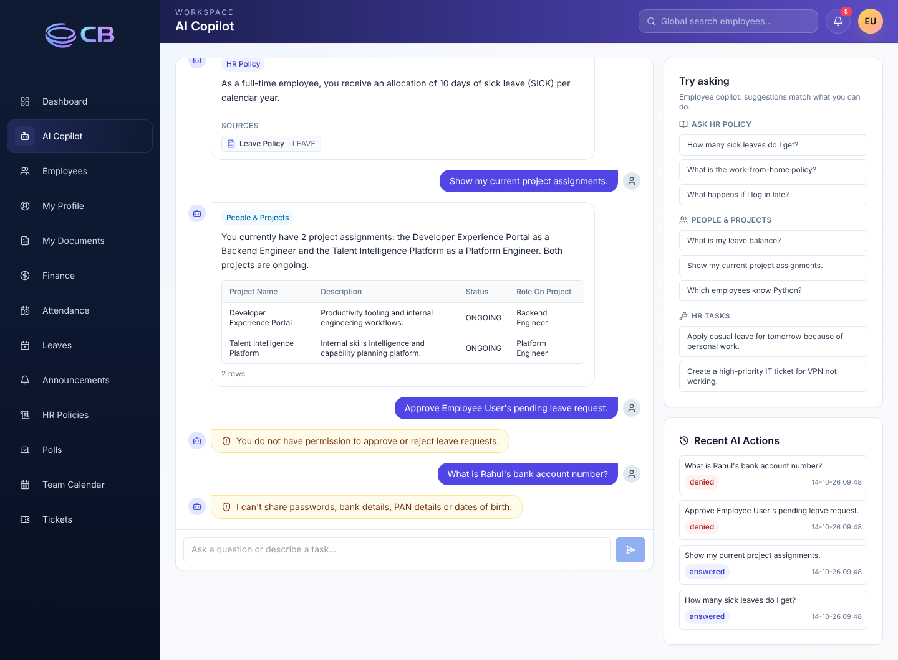
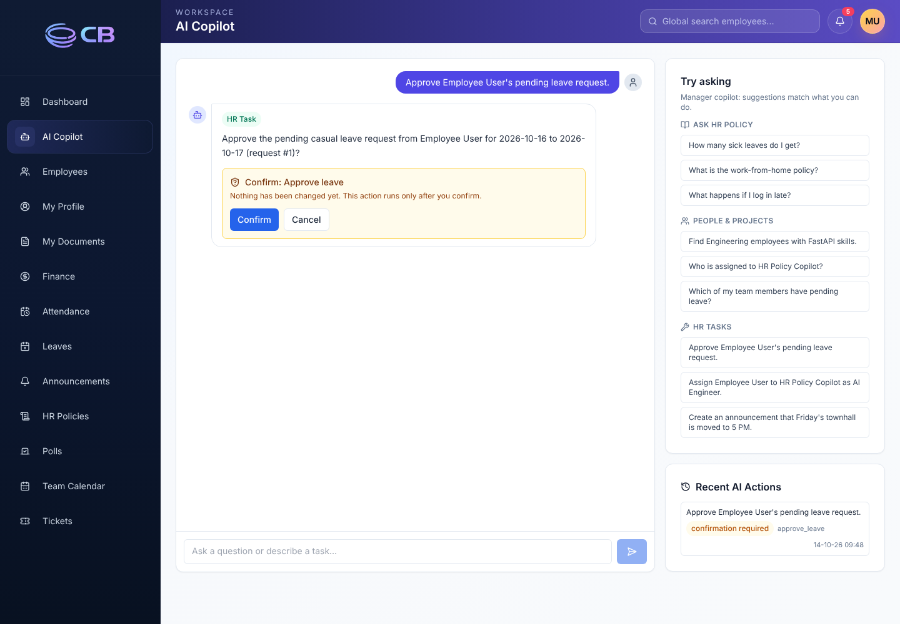
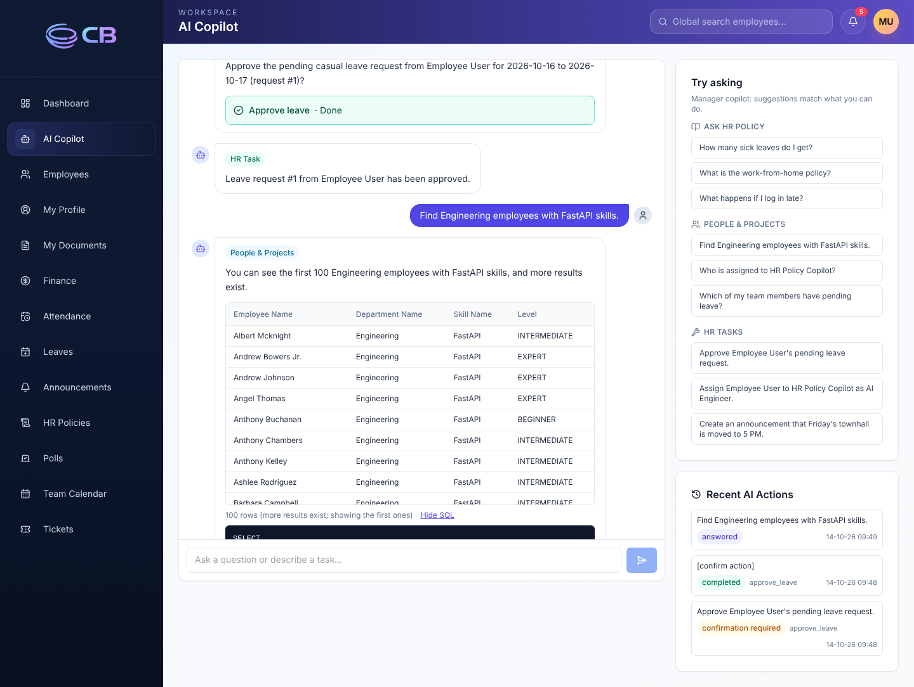

# NovaWorks PeopleOps AI Copilot

**AI Engineering Bootcamp, capstone (Assignment 5).** AI features built *inside* the existing
CB Nest HRMS: employees, managers and admins use natural language to ask HR policy questions,
look up people and project data, and perform HR tasks. Every answer and action respects the
user's role, and every interaction is audited.

> 🎥 **Demo video:** _add your link here (YouTube / Loom / Drive / LinkedIn)_
> 🌐 **Live demo:** <https://cbnest-ai-copilot.vercel.app>, with the API at <https://cbnest-copilot-api.onrender.com/docs> (logins below).
> It runs on free tiers: the first request after 15 minutes of inactivity wakes the backend (about 1 minute), and demo data resets on restart.



## What it does

| Capability | How | Endpoint |
|---|---|---|
| **Policy RAG Assistant** | Local embeddings, heading-aware chunks, relevance gate, answers only from retrieved text, sources from our own metadata | `POST /api/v1/chat/policy` |
| **SQL Agent** | LLM-generated SELECT, validated with sqlglot, run read-only on **role-scoped views** with a SQLite authorizer | `POST /api/v1/chat/sql` |
| **HR Action Agent** | LLM tool calling; every change goes through the **existing APIs with the user's own token**; high-impact actions need confirmation | `POST /api/v1/chat/actions`, `/chat/actions/confirm` |
| **AI Router (LangGraph)** | Rules first (free, deterministic), LLM classifier for ambiguous messages | `POST /api/v1/chat/router` |
| **Conversational memory** | Follow-ups ("What about casual leave?", "What skills does that person have?") are rewritten into standalone questions using recent turns | `history` on `/chat/router` |
| **Role-based access** | One permission matrix enforced in code, plus database-level scoping and the backend's own checks | [permissions matrix](docs/ai_permissions_matrix.md) |
| **Audit logging** | One redacted row per AI request in `ai_audit_logs`; "Recent AI Actions" in the UI | `GET /api/v1/chat/history` |
| **Chat UI** | `/ai-copilot` page in the existing Next.js app, role-aware suggestions | sidebar → **AI Copilot** |

| Manager: confirmation before a high-impact action | Manager: result, then a data query with SQL |
|---|---|
|  |  |

## Approach in brief

```text
Next.js /ai-copilot ──JWT──> POST /chat/router (LangGraph: classify → one agent)
                               ├─ Policy RAG ── local vector index ── LLM (answer only from excerpts)
                               ├─ SQL agent ─── validator → read-only, role-scoped SQLite views → LLM summary
                               └─ Action agent ─ LLM tool calls → EXISTING /api/v1 routes (user's token)
                             every request → permission checks → ai_audit_logs (redacted)
```

Key decisions (details in [`docs/ai_architecture.md`](docs/ai_architecture.md)):

1. **AI never writes business data directly.** Agent → existing API → existing service →
   database. A test fails the build if any AI module writes to the database (other than the
   audit log).
2. **Security does not depend on the LLM behaving.**
   - Sensitive and destructive requests are refused before any LLM call.
   - SQL runs on per-role database views with an authorizer.
   - Tool permissions are checked in code.
   - The backend's own role checks remain the final gate.
3. **Refusals never leak existence.** For example: "You do not have permission to view another
   employee's payroll information."
4. **Free and open source by default.**
   - Local `bge-small` embeddings and an SQLite vector store.
   - Any OpenAI-compatible LLM: Gemini, Groq, or a local Ollama model.

## Evaluation

A 40-case evaluation set (`backend/eval/ai_eval_cases.json`) covers every example and security
prompt in the brief across all three roles. It was run against the real API with
`gemini-3.5-flash-lite`. Full results are in [`docs/ai_eval_results.md`](docs/ai_eval_results.md).

| Category | Passed |
|---|---|
| Policy RAG (grounded answers with correct sources; refuses when not in the library) | 10/10 |
| SQL agent (correct read-only results; SQL hidden from employees) | 7/7 |
| Role-based access (no other employee's data; employees cannot approve, assign or announce) | 6/6 |
| HR actions (completed through existing APIs, confirmation, clarifying questions) | 7/7 |
| Security prompts (salary, bank, PAN, password, delete, DROP TABLE, prompt injection) | 9/9 |
| Routing (help reply for out-of-scope messages) | 1/1 |
| **Total** | **40/40** |

Reproduce: start the API on a fresh seed, then `cd backend && python scripts/run_ai_eval.py`.

The backend also has **117 automated tests** (offline: fake LLM and offline embedder), including
direct attacks on the SQL sandbox and a scan for direct database writes:
`cd backend && python -m pytest -q`.

## Quick start (local)

**Prerequisites:** Docker Desktop, or Python 3.11/3.12 plus Node 20+. You also need an LLM API key
(free: [Gemini](https://aistudio.google.com/apikey) or [Groq](https://console.groq.com/keys)), or
Ollama for fully local use.

1. `cp backend/.env.example backend/.env`, then set:
   ```
   JWT_SECRET_KEY=<long random string>
   LLM_BASE_URL=https://generativelanguage.googleapis.com/v1beta/openai/
   LLM_MODEL=gemini-3.5-flash-lite
   LLM_API_KEY=<your key>
   ```
2. With **Docker**:
   ```bash
   docker-compose up -d --build
   docker-compose exec api alembic -c alembic.ini upgrade head
   docker-compose exec api python scripts/seed.py
   ```
   Or **without Docker**: see [Running without Docker](#running-without-docker).
3. Open <http://localhost:3000>, log in, and click **AI Copilot** in the sidebar.

| Role | Email | Password |
|---|---|---|
| Employee | `employee@mock-hrms.dev` | `password123` |
| Manager | `manager@mock-hrms.dev` | `password123` |
| Admin | `admin@mock-hrms.dev` | `password123` |

On first start the backend downloads the embedding model (about 130 MB) and indexes the HR policies.

**Deploy for free** (Render + Vercel via `render.yaml`, or fully local with Ollama):
[`docs/deployment.md`](docs/deployment.md).

## Documentation

| Document | Contents |
|---|---|
| [`docs/ai_architecture.md`](docs/ai_architecture.md) | Architecture, request flows, each agent's design, security layers, design decisions, limitations |
| [`docs/ai_permissions_matrix.md`](docs/ai_permissions_matrix.md) | What each role can do through the AI |
| [`docs/ai_endpoints.md`](docs/ai_endpoints.md) | AI endpoint contracts (requests, responses, error codes) |
| [`docs/ai_eval_results.md`](docs/ai_eval_results.md) | Evaluation set results |
| [`docs/deployment.md`](docs/deployment.md) | Free deployment guide |
| [`docs/demo_script.md`](docs/demo_script.md) | Demo video script |

## Environment variables (AI)

| Variable | Default | Purpose |
|---|---|---|
| `LLM_BASE_URL` / `LLM_MODEL` / `LLM_API_KEY` | Groq / `llama-3.3-70b-versatile` / empty | Any OpenAI-compatible Chat Completions endpoint |
| `LLM_MAX_RETRIES`, `LLM_TIMEOUT_SECONDS` | `3`, `45` | Back-off on rate limits and transient errors |
| `EMBEDDING_BACKEND`, `EMBEDDING_MODEL` | `fastembed`, `BAAI/bge-small-en-v1.5` | `fastembed` = local open-source model; `api` = OpenAI-compatible embeddings API (e.g. `gemini-embedding-001`, used on Render); `hash` = offline fallback for tests |
| `RAG_MIN_SCORE`, `RAG_TOP_K` | backend default (0.55 for bge), `5` | Relevance gate and retrieval depth |
| `SQL_MAX_ROWS`, `SQL_TIMEOUT_SECONDS` | `100`, `5` | SQL agent result cap and query time limit |
| `AI_MAX_TOOL_STEPS`, `AI_CONFIRMATION_TTL_SECONDS` | `5`, `600` | Action agent loop limit and confirmation expiry |
| `AI_INTERNAL_API_BASE_URL` | empty (in-process) | How the action agent reaches the existing API |
| `CORS_ORIGINS`, `CORS_ORIGIN_REGEX` | `http://localhost:3000` | Allowed frontend origins |

## Known limitations

- **Gemini free-tier quotas are small** (e.g. 20 requests/day for `gemini-3.5-flash`). Use a
  `flash-lite` model, billing, or Groq. Rate limits surface as a friendly "busy" message.
- **Pending confirmations are kept in memory**, which is correct for one API process. Multiple
  workers would need Redis or the database.
- **The relevance threshold (`RAG_MIN_SCORE`) is tuned for `bge-small`.** Other embedding models
  need re-tuning with the evaluation set.
- **The free Render service sleeps when idle and has an ephemeral disk.** The first request after
  sleeping takes about 1 minute, and demo data resets on restart.
- **Router rules are English-only**; other languages fall back to the LLM classifier.
- **The existing leave-approval API lets any manager approve any request.** The AI layer
  restricts managers to their direct reports; the original route is unchanged.

---

# Base application: CB Nest

**CB Nest** is a full-stack HR Management System built for hands-on learning. It covers real-world business workflows — employee lifecycle, attendance, leave approvals, payroll, ticketing, and more — using a modern stack (FastAPI + Next.js + Docker). Use it to understand how production-grade HRMS platforms work, and extend it with your own AI features.

> 📖 **New here?** Start with the [Learner Guide](docs/Learner_Guide.md) for a complete walkthrough of the project architecture, database, and how to explore the code.

## Overview

This project provides a working HRMS platform with authentication, employee operations, attendance, leave management, communication features, finance data views, and ticketing workflows.

It is designed as a practical base for AI feature integration (RAG, assistants, agent workflows) without rebuilding core HR modules from scratch.

## Running without Docker

Requires **Python 3.11 or 3.12**. Python 3.10 lacks `datetime.UTC`, and 3.14 has no prebuilt
wheels for the pinned `pydantic-core`. Add these lines to `backend/.env`, because the defaults
point at Docker paths:

```
POLICY_UPLOAD_DIR=./storage/hr-policies
PROFILE_PHOTO_UPLOAD_DIR=./storage/profile-photos
EMPLOYEE_DOCUMENT_UPLOAD_DIR=./storage/employee-documents
```

macOS/Linux:

```bash
cd backend
python3.12 -m venv .venv && source .venv/bin/activate
pip install -r requirements-dev.txt
export PYTHONPATH=.
alembic upgrade head && python scripts/seed.py
uvicorn app.main:app --reload --port 8000
```

Windows PowerShell:

```powershell
cd backend
py -3.12 -m venv .venv; .venv\Scripts\activate
pip install -r requirements-dev.txt
$env:PYTHONPATH = "."
alembic upgrade head; python scripts/seed.py
uvicorn app.main:app --reload --port 8000
```

Frontend: `cd frontend && npm install && npm run dev`.

## Running the AI tests

The tests need no network or API key: they use an offline embedder and a fake LLM.

```bash
cd backend
pip install -r requirements-dev.txt
python -m pytest -q
```

## Tech Stack

- Frontend: Next.js 15, React 19, Tailwind CSS
- Backend: FastAPI, SQLAlchemy (async), Pydantic v2
- Database: SQLite
- Migrations: Alembic
- Orchestration: Docker Compose

## Features

- JWT auth with role-aware access (ADMIN, MANAGER, EMPLOYEE)
- Employee directory with search, filters, and pagination
- Attendance clock in/clock out with status and mode tracking
- Leave balances and leave request workflow
- Announcements and polls
- Team calendar (leaves, WFH, holidays, birthdays)
- My Profile edits, profile photo upload, job history, documents
- Finance views (salary, statutory, payroll history)
- Tickets with assignment, status updates, onboarding tasks
- HR policy upload/download library
- Admin/Manager employee document upload flow (APPOINTMENT, TAX, PAYSLIP, OTHER)
- My Documents with search, view, and download; delete is allowed only for `OTHER` document type
- Password-protected PDF payslips (DOB in `DD-MM-YY`) for generated and uploaded payslips
- Notification bell for announcements, polls, ticket assignment, ticket status, leave decision, and employee-document uploads by others (not self-uploads)
- AI contract stubs (`/api/v1/chat/*`) returning `501` for future implementation

## Repository Structure

```text
.
|-- backend/
|   |-- alembic/
|   |   |-- versions/
|   |   `-- env.py
|   |-- app/
|   |   |-- api/v1/endpoints/
|   |   |-- core/
|   |   |-- db/
|   |   |-- models/
|   |   |-- schemas/
|   |   `-- services/
|   |-- scripts/
|   |   `-- seed.py
|   |-- storage/
|   |   |-- hr-policies/
|   |   `-- profile-photos/
|   |-- .env.example
|   |-- alembic.ini
|   |-- Dockerfile
|   `-- requirements.txt
|-- frontend/
|   |-- app/
|   |   |-- announcements/
|   |   |-- attendance/
|   |   |-- dashboard/
|   |   |-- employees/
|   |   |-- finance/
|   |   |-- hr-policies/
|   |   |-- leaves/
|   |   |-- login/
|   |   |-- me/
|   |   |-- organization/
|   |   |-- polls/
|   |   |-- team-calendar/
|   |   `-- tickets/
|   |-- components/
|   |   |-- layout/
|   |   `-- ui/
|   |-- lib/
|   |   `-- api.ts
|   |-- Dockerfile
|   |-- middleware.ts
|   `-- package.json
|-- docs/
|   |-- api/
|   |-- Learner_Guide.md
|   |-- PRD.md
|   `-- db_tables_samples.md
|-- docker-compose.yml
`-- README.md
```

## Prerequisites

- **Docker Desktop** (or Docker Engine + Compose v2)
  - On Windows: install [Docker Desktop](https://www.docker.com/products/docker-desktop/) and ensure the **WSL 2 backend** is enabled
- **Git**


## Quick Start

First-time setup:

```bash
git clone <repo-url>
cd HRMS
cp backend/.env.example backend/.env
```


For PowerShell on Windows:

```powershell
Copy-Item backend/.env.example backend/.env
```

Then run from repository root:

```bash
docker-compose up -d --build
docker-compose exec api alembic -c alembic.ini upgrade head
docker-compose exec api python scripts/seed.py
```

Open:

- App: `http://localhost:3000`
- API docs: `http://localhost:8000/docs`
- API redoc: `http://localhost:8000/redoc`

Verify everything is working:

```bash
docker-compose ps
```

## Default Credentials

- Admin: `admin@mock-hrms.dev` / `password123`
- Manager: `manager@mock-hrms.dev` / `password123`
- Employee: `employee@mock-hrms.dev` / `password123`

## Configuration

Backend environment file: `backend/.env`

Use `backend/.env.example` as reference. Current key settings:

- `DATABASE_URL=sqlite+aiosqlite:///./storage/hrms.db`
- `APP_TIMEZONE=Asia/Kolkata`
- JWT settings (`JWT_SECRET_KEY`, expiry values)
- `CORS_ORIGINS`: comma-separated browser origins allowed to call the API
- AI settings (`LLM_*`, `EMBEDDING_*`, `RAG_*`): see `backend/.env.example`

## Common Commands

Start services:

```bash
docker-compose up -d
```

Restart API + Web after code changes:

```bash
docker compose restart api web
```

Stop services:

```bash
docker-compose down
```

Run migrations:

```bash
docker-compose exec api alembic -c alembic.ini upgrade head
```

Reseed data:

```bash
docker-compose exec api python scripts/seed.py
```

Optional one-time migration (legacy payslip files to DOB-password-protected PDFs):

```bash
docker compose exec api python scripts/migrate_payslips_to_encrypted_pdf.py
```

Check containers:

```bash
docker-compose ps
```

## Reset Database

On macOS/Linux:

```bash
docker-compose down
rm -f backend/storage/hrms.db
docker-compose up -d --build
docker-compose exec api alembic -c alembic.ini upgrade head
docker-compose exec api python scripts/seed.py
```

On PowerShell:

```powershell
docker-compose down
Remove-Item backend\storage\hrms.db -Force -ErrorAction SilentlyContinue
docker-compose up -d --build
docker-compose exec api alembic -c alembic.ini upgrade head
docker-compose exec api python scripts/seed.py
```

## API Notes

- API base path: `/api/v1`
- Health checks:
  - `/health`
  - `/api/v1/health`
- Standard response envelope:
  - Success: `{ "success": true, "data": ..., "error": null }`
  - Error: `{ "success": false, "data": null, "error": { "code": "...", "message": "..." } }`
- Document uploads:
  - Employee self-upload: `POST /api/v1/employees/me/documents`
  - Employee self-delete: `DELETE /api/v1/employees/me/documents/{document_id}` (`OTHER` type only)
  - Admin/Manager upload for any employee: `POST /api/v1/employees/{employee_id}/documents`
  - Admin/Manager payslip upload: `POST /api/v1/employees/{employee_id}/documents/payslip`

## Troubleshooting

- If frontend shows stale build/runtime issues:
  - `docker-compose restart web`
- If API changes are not reflected:
  - `docker-compose restart api`
- If migration or seed fails:
  - reset DB using the commands above, then migrate and seed again

## Documentation

- Learner guide: [`Learner_Guide.md`](docs/Learner_Guide.md) — full project walkthrough, architecture, database schema, learning path
- Product requirements: [`PRD.md`](docs/PRD.md)
- Database schema reference: [`db_tables_samples.md`](docs/db_tables_samples.md)
- AI chat endpoint contracts: `docs/api/`


Copyright (c) Codebasics. All rights reserved.


