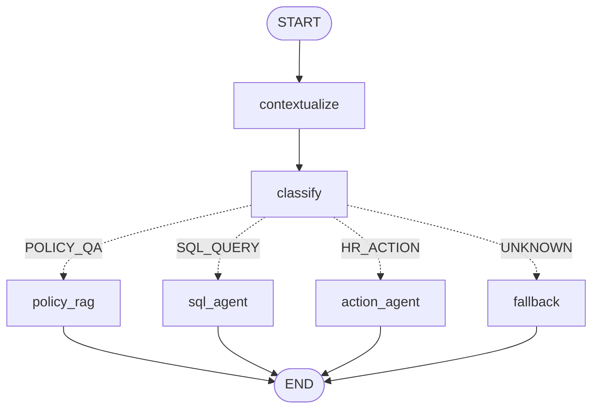

# PeopleOps AI Copilot: Architecture

> Status: Policy RAG, the read-only SQL agent, the HR action agent, the LangGraph router, the
> permission layer, audit logging and the `/ai-copilot` frontend are implemented.

## Request flow

```text
Next.js /ai-copilot
        │  Authorization: Bearer <JWT>
        ▼
POST /api/v1/chat/policy
        │
        ├─ get_current_user (existing JWT auth)
        ├─ load_user_context → UserContext(id, role, team_ids)
        ├─ permission check (permissions.PERMISSION_MATRIX)
        ├─ PolicyRAGService.answer
        │     ├─ sync_index: re-embed only policies whose version changed
        │     ├─ retrieve: top-k cosine search in the local vector store
        │     ├─ relevance gate: no chunk ≥ min score → refuse, LLM is NOT called
        │     ├─ LLM (JSON mode): answer only from <policy_excerpts>, cite excerpt ids
        │     └─ validate: sufficient + non-empty + citations that exist, else refuse
        ├─ sources built from our own chunk metadata (title, category, filename)
        └─ write_audit_log (message redacted)
```

## Components

| File | Responsibility |
|---|---|
| `app/services/ai/permissions.py` | Permission matrix, `UserContext`, refusal messages, forbidden columns |
| `app/services/ai/audit.py` | Redaction and one audit row per AI request |
| `app/services/ai/llm.py` | OpenAI-compatible client (Groq, Gemini, Ollama, OpenAI) |
| `app/services/ai/embeddings.py` | Local `fastembed` model; offline `hash` fallback for tests |
| `app/services/ai/vector_store.py` | SQLite-backed vector store with exact cosine search |
| `app/services/ai/policy_rag.py` | Ingestion, chunking, indexing, retrieval, grounded answering |
| `app/services/ai/warmup.py` | Loads the model and builds the index when the API starts |
| `app/services/ai/sql_guardrails.py` | sqlglot-based validation of generated SQL |
| `app/services/ai/sql_agent.py` | Question screening, role-scoped views, read-only executor, SQL agent |
| `app/services/ai/api_tools.py` | Typed tools wrapping the existing API routes; `HRApiClient` |
| `app/services/ai/action_agent.py` | Tool-calling loop, permission enforcement, confirmation store |
| `app/services/ai/router.py` | LangGraph router: rule + LLM intent classification, dispatch to agents |
| `app/services/ai/errors.py` | `AIRequestError`: user-facing refusals and failures |
| `app/api/v1/endpoints/chat.py` | `/chat/policy`, `/chat/policy/reindex`, `/chat/sql`, `/chat/actions`, `/chat/actions/confirm`, `/chat/router`, `/chat/history`; shared error handling and audit |
| `app/models/ai_audit_log.py` + migration `0017` | `ai_audit_logs` table |

## Policy RAG details

- **Ingestion.** Text comes from `hr_policies.content` when present, otherwise from the stored
  `.md`, `.txt` or `.pdf` file. Files are only read from inside `POLICY_UPLOAD_DIR`.
- **Chunking.** Markdown-heading aware. Each chunk is prefixed with `Policy title > Section` so
  retrieval and the LLM both see where the text came from. Default 900 characters.
- **Incremental indexing.** Each policy has a version hash (title, category, checksum, path,
  content). Only changed policies are re-embedded; deleted policies are removed. The index
  syncs on startup, before each question, and on `POST /chat/policy/reindex` (admin only).
- **Grounding.**
  - A relevance threshold blocks the LLM from answering out-of-scope questions from memory.
  - The model must return `{"sufficient", "answer", "citations"}`.
  - Answers without valid citations are replaced with a fixed refusal.
  - Sources are taken from our metadata, never from model output, so they cannot be invented.
- **Prompt-injection defence.**
  - Excerpts are wrapped in `<policy_excerpts>` and HTML-escaped, so a document cannot close the delimiter.
  - The system prompt declares excerpt text as untrusted data.
  - Covered by `tests/test_policy_chat.py::test_injected_instructions_in_policy_are_escaped_as_data`.

## SQL agent details

```text
POST /api/v1/chat/sql
  ├─ screen_question     secrets / payroll → 403, data changes → 400   (no LLM call)
  ├─ LLM: question → {"sql", "explanation", "cannot_answer_reason"} using an allowlisted schema
  ├─ validate_select     one SELECT, allowlisted tables, no forbidden columns/functions,
  │                      no schema prefixes; wrapped in LIMIT SQL_MAX_ROWS + 1
  ├─ execute_scoped      read-only connection + role-scoped TEMP VIEWs + authorizer + timeout
  │     (one retry with the error fed back to the LLM; destructive SQL is never retried)
  ├─ LLM: rows → 1-3 sentence summary (rows treated as untrusted data; skipped when empty)
  └─ response: answer, columns, rows, row_count, truncated, sql (managers/admins only)
```

**Six layers of protection.** Each layer works on its own; none relies on the LLM behaving.

1. **Question screening.** Requests for passwords, bank details, PAN, date of birth or payroll,
   and requests to change data, are refused deterministically.
2. **Schema allowlist.** The model only sees 10 tables, without any sensitive column.
3. **SQL validation (sqlglot).**
   - Token-level keyword blocklist (so `LIKE '%update%'` is fine).
   - Exactly one statement, which must be a SELECT, UNION, INTERSECT or EXCEPT.
   - Allowlisted tables only, and no `main.` or `temp.` prefixes.
   - No forbidden columns, and no dangerous functions such as `load_extension`.
4. **Role-scoped views.** Each request opens a fresh `mode=ro` connection and creates TEMP VIEWs
   with the *same names* as the real tables. SQLite resolves unqualified names to `temp` first,
   so any query only sees the role's rows and columns:

   | Data | Employee | Manager | Admin |
   |---|---|---|---|
   | Directory: name, email, department, manager, role, skills | Everyone | Everyone | Everyone |
   | Phone, address, blood type | Self only | Self + team | Everyone |
   | Leave, project assignments, job history | Self only | Self + team | Everyone |
   | Tickets | Own or assigned | Team or assigned | Everyone |
   | Projects, departments, skills | Everyone | Everyone | Everyone |
   | Payroll, passwords, bank, PAN, DOB, salary | Never | Never | Never |

5. **SQLite authorizer.** A real table may only be read by an internal view whose name has a
   random per-request prefix, so a query or CTE cannot impersonate one. It also denies:
   - forbidden columns
   - row-only reads (`count(*)`, rowid) of tables outside the allowlist
   - PRAGMA, ATTACH and every write
6. **Resource limits.**
   - `PRAGMA query_only`.
   - A progress handler aborts queries after `SQL_TIMEOUT_SECONDS`.
   - Results are capped at `SQL_MAX_ROWS` and flagged as `truncated`.

The tests in `tests/test_sql_agent.py` attack layers 4–6 directly, bypassing the validator, to
prove they hold on their own.

## HR action agent details

```text
POST /api/v1/chat/actions {message, history?}
  ├─ screen: "delete all…" → 400, secrets / payroll → 403            (no LLM call)
  ├─ loop (max AI_MAX_TOOL_STEPS): LLM chooses a tool
  │     ├─ permission check in code (matrix + manager team scope + no self-approval)
  │     ├─ arguments validated with Pydantic; errors are fed back to the LLM
  │     ├─ read tool        → call existing GET route, result back to the LLM (as untrusted data)
  │     ├─ write tool       → call existing POST route with the USER'S token → deterministic summary
  │     └─ high-impact tool → no call; return CONFIRMATION_REQUIRED + one-time confirmation_id
  └─ no tool call → the LLM's answer (or a clarifying question)

POST /api/v1/chat/actions/confirm {confirmation_id, approve}
  └─ token must belong to the same user and be unused and unexpired (AI_CONFIRMATION_TTL_SECONDS)
     → permissions re-checked → existing API route called → summary
```

**Agent → existing API → existing service → database.** Every tool wraps an existing route:

| Tool | Existing route | Who | Confirmation |
|---|---|---|---|
| `get_my_leave_balance`, `get_my_leave_requests` | `GET /leaves/balances/me`, `/leaves/requests/me` | Everyone | – |
| `get_my_tickets` | `GET /tickets?mine=true` | Everyone | – |
| `search_employees` | `GET /employees?q=` | Everyone | – |
| `list_pending_leave_requests` | `GET /leaves/requests/pending` (filtered to team) | Manager, Admin | – |
| `list_open_tickets`, `list_projects` | `GET /tickets`, `GET /employees/projects/catalog` | Manager, Admin | – |
| `apply_leave` | `POST /leaves/requests` | Everyone | – |
| `create_ticket` | `POST /tickets` | Everyone | – |
| `approve_leave`, `reject_leave` | `POST /leaves/requests/{id}/approve` or `/reject` | Manager (team), Admin | ✅ |
| `assign_ticket`, `update_ticket_status` | `POST /tickets/{id}/assign`, `/status` | Manager, Admin | ✅ |
| `create_announcement` | `POST /announcements` | Manager, Admin | ✅ |
| `assign_employee_to_project`, `create_project` | `POST /employees/{id}/projects`, `/employees/projects/catalog` | Manager, Admin | ✅ |

Design points:
- **Permissions are enforced in code, not by the prompt.**
  - The model may propose any tool, but nothing runs or gets proposed until the matrix allows it.
  - So "Approve Rahul's leave" from an employee always returns the same refusal, and is audited as `DENIED`.
  - The backend's own role checks remain the final gate.
- **Stricter than the existing API where the matrix requires it.**
  - Managers can only decide leave for their direct reports.
  - Nobody can approve their own leave.
  - Employees cannot change ticket status through the AI, although the existing route allows it.
- **Write summaries are deterministic**, built from the API response. The LLM never describes a
  write that did not happen.
- **In-process API calls by default.**
  - `HRApiClient` uses httpx's ASGI transport, so the full FastAPI stack runs (routing, JWT
    dependency, validation, services) without a network hop.
  - Set `AI_INTERNAL_API_BASE_URL` to use real HTTP instead.
  - The chat request ends its own read transaction before tool calls, so SQLite's writer lock
    is free.
- **Provider quirks are handled.** The provider's assistant message is sent back unchanged in the
  next turn. Gemini 3 requires its `thought_signature` to be echoed with tool calls.
- **No direct writes.** `tests/test_action_agent.py::test_ai_layer_never_writes_business_tables_directly`
  scans the AI package and fails if any module other than the audit log or the vector index writes
  to a database.

## AI router (LangGraph)

`POST /api/v1/chat/router` is the single entry point used by the chat UI. It is a compiled
LangGraph `StateGraph`:



**Conversational memory (`contextualize` node).** The UI sends the last 6 turns as `history`.
A follow-up is rewritten into a standalone message with one LLM call, and every later node
(classification, RAG, SQL, actions) works on that message. Examples from a live run:
- "What about casual leave?" → "How many casual leaves do I get?"
- "What skills does that person have?" → "What skills does Admin User have?"
- "27 to 28 October, sick leave, dental surgery" (after "Which dates…?") → a complete leave request

The rewrite only runs when it is needed:
- **When it runs:** there is history, and the message refers back ("it", "that", "his",
  "what about…"), or answers the assistant's question, or is a short message the rules cannot
  classify.
- **When it is skipped:** standalone messages cost nothing extra.
- **Safety:** messages with injection, sensitive-data or destructive wording are never rewritten,
  so they reach the deterministic refusals unchanged. The rewritten text is screened again.
- **Failure:** a failed rewrite falls back to the original message.
- **Visibility:** the response carries `interpreted_as`; the UI shows "Understood as: …", and the
  audit row records it.

**Two-stage classification.**
1. **Deterministic rules** run first, in this order:
   - injection phrases → refused (400)
   - SQL text → data agent, which refuses writes
   - imperative verbs ("Apply…", "Approve…") → actions
   - sensitive-data requests → data agent, which refuses them
   - lookup openers ("Who…", "Show…") → data
   - policy words → policy, but only when no data nouns appear (so "Who is assigned to HR
     *Policy* Copilot?" is not a policy question)
2. **The LLM** classifies only messages with no rule match or conflicting signals, returning
   `{intent, confidence, reason}`. Below 0.5 confidence the message falls back to a help reply.

19 of the brief's 19 example prompts are routed by rules, at zero LLM cost
(`tests/test_router.py::test_rules_route_brief_prompts`).

The router is not a security boundary. Every agent keeps its own screening and permission checks,
so a misrouted message still cannot do anything the user is not allowed to do. The response
carries `intent`, `confidence`, `reason`, `routed_by` (`rules` or `llm`) and the agent's
`result`. The audit row records the resolved intent and the agent, for example
`router>action_agent`.

`GET /api/v1/chat/history` returns the caller's own recent AI interactions from the audit log,
already redacted. It powers "Recent AI Actions" in the UI.

## Frontend (`/ai-copilot`)

| File | Responsibility |
|---|---|
| `frontend/app/ai-copilot/page.tsx` | Page shell (existing Sidebar/Topbar), role-aware suggestions, Recent AI Actions |
| `frontend/components/ai/chat-panel.tsx` | Conversation, router calls, loading/error/refusal states, confirmations |
| `frontend/components/ai/source-list.tsx` | Policy sources under RAG answers |
| `frontend/components/ai/sql-result-table.tsx` | Result table, truncation note, "Show SQL" (only when the API returns it) |
| `frontend/components/ai/action-result-card.tsx` | Confirm/Cancel card for high-impact actions; Done/Cancelled outcome |
| `frontend/lib/api.ts` | Typed `askCopilot`, `confirmCopilotAction`, `fetchCopilotHistory` |

- **One chat box for everything.** Messages go to `/chat/router`; each answer is labelled by
  intent (HR Policy, People & Projects, HR Task).
- **Role-aware, without the UI being a security boundary.**
  - Suggested prompts match each role, so the UI never invites a refusal.
  - Raw SQL appears only because the API returns it to managers and admins.
  - Every check also happens on the backend.
- **Refusals look like answers, not crashes.** `FORBIDDEN`, `READ_ONLY`, blocked requests and
  rate limits are shown in amber; real failures in red.
- **Follow-up questions work.** The last 6 text turns are sent as `history`, so the assistant can
  continue after asking a clarifying question such as "Which dates?".
- `/ai-copilot` is protected by the existing auth middleware and linked in the sidebar.

**Existing build blockers fixed.** `next build` failed on the base app before any AI code was
added, for two reasons:
- a TypeScript narrowing error in `app/polls/page.tsx`
- `useSearchParams()` without a `<Suspense>` boundary in four `employees` pages

Both are minimal, behaviour-preserving fixes, needed to deploy the frontend (for example on Vercel).

## Key design decisions

| Decision | Alternative | Why |
|---|---|---|
| Local vector store (SQLite + NumPy) | ChromaDB | Chroma pulls in Kubernetes, gRPC and OpenTelemetry and conflicts with the app's pinned pydantic. A few hundred chunks search in microseconds with brute force, and it fits free hosting tiers. |
| Local open-source embeddings (`bge-small-en-v1.5` via fastembed) by default; `api` backend (Gemini `gemini-embedding-001`) for the hosted demo | Embedding API only | Local is free and offline. The 512 MB free host cannot fit ONNX Runtime plus the model alongside the app; with API embeddings the backend uses about 180 MB. Relevance threshold calibrated per backend: Gemini scores 0.73–0.87 for answerable questions vs 0.46–0.49 off-topic, so the default is 0.6. |
| One OpenAI-compatible client | Provider SDKs | Switching Groq, Gemini or Ollama is a configuration change only. |
| Rules first, LLM classifier for ambiguous messages | LLM-only routing | Free, instant and predictable for clear messages; saves quota. |
| Relevance gate before the LLM | Always call the LLM | Out-of-scope questions are refused deterministically and cost nothing. |
| Audit write never raises | Fail the request | A logging failure must not break the user's request; it is logged instead. |
| Role scoping with database views | Asking the LLM to add `WHERE` filters | A prompt can be talked out of a filter; a view cannot. |
| Screening sensitive questions before the LLM | Relying on the model to refuse | Deterministic, instant, free, and testable. |
| No LIMIT from the model; the app caps rows | Model-chosen LIMIT | The app knows when results were truncated and says so honestly. |

## Configuration

See `backend/.env.example`. The key variables are `LLM_BASE_URL`, `LLM_MODEL`, `LLM_API_KEY`,
`EMBEDDING_BACKEND`, `EMBEDDING_MODEL`, `RAG_MIN_SCORE` and `CORS_ORIGINS`.

## Known limitations (so far)

- Gemini's free tier has small daily quotas (`gemini-3.5-flash`: 20 requests/day). A SQL
  question uses 2 requests (generate + summarize). Use a `flash-lite` model, or another provider
  such as Groq, for development and evaluation. Rate limits return `429 AI_RATE_LIMITED`.
- Pending confirmations are kept in memory (single API process). A multi-worker deployment would
  store them in the database or Redis.
- The keyword blocklist rejects SQLite's `replace()` string function, because `REPLACE` is also a
  write statement. This is an acceptable trade-off for this use case.

- `RAG_MIN_SCORE` defaults to 0.55 for `bge-small`. Calibrate it on the evaluation set; the
  offline `hash` backend uses 0.12.
- The existing leave-approval API lets any manager approve any pending leave. The AI layer will
  restrict managers to their direct reports (see the permissions matrix).
